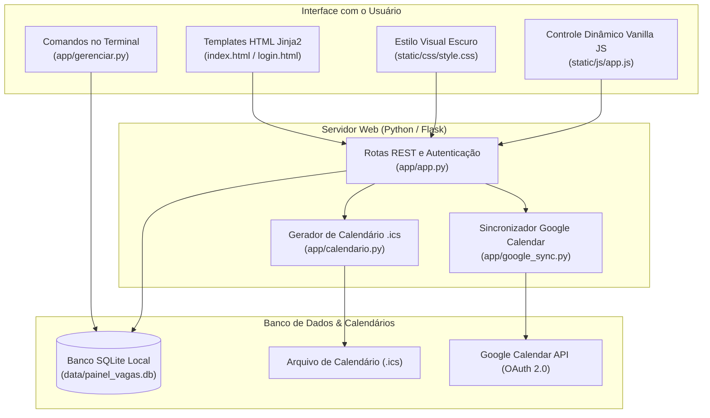

# Painel de Vagas e Candidaturas (Flask + SQLite)

Aplicação web e utilitário de terminal (CLI) para organizar processos seletivos, contatos de networking, anotações de entrevistas e sincronização automática de prazos com calendários (**Google Calendar** e padrão universal **iCalendar / .ics**).

---

## Arquitetura da Aplicação



---

## O que a Aplicação Faz

- **Acompanhamento de Vagas:** Cadastro de empresas, cargos, modalidade (remoto, híbrido ou presencial), tecnologias exigidas, faixas de bolsa/remuneração e status da etapa atual (inscrito, entrevista, case, proposta).
- **Rede de Contatos (Networking):** Registro de recrutadores e engenheiros, histórico de mensagens enviadas no LinkedIn e tarefas de follow-up.
- **Base de Conhecimento:** Fichas rápidas com o perfil técnico de cada empresa para você revisar antes de uma entrevista técnica.
- **Sincronização com Calendário:**
  - Gera um link de assinatura `.ics` que atualiza seus prazos direto no celular (compatível com Google Agenda, Apple Calendar e Outlook).
  - Permite conectar sua conta do Google via OAuth 2.0 para criar eventos com alarmes automaticamente na sua agenda.
- **Acesso pelo Terminal:** Script `gerenciar.py` para consultar rapidamente suas vagas e tarefas pendentes sem precisar abrir o navegador.
- **Segurança:** Acesso protegido por PIN com hash seguro (PBKDF2-SHA256) e bloqueio temporário contra tentativas repetidas.
- **Dados Iniciais de Demonstração (Mock Data 100% Fictício):** Na primeira inicialização, o banco cria registros com o prefixo explícito `[EXEMPLO] (Fictício)` e valores zerados (`R$ 0.000`), servindo unicamente para testar a renderização dos componentes visuais sem conter nenhuma informação real.

---

## Estrutura de Pastas

```
painel-vagas-flask/
├── app/
│   ├── app.py                  # Servidor Flask, rotas da API e criação automática do banco
│   ├── calendario.py           # Geração do feed de calendário (.ics / RFC 5545)
│   ├── google_sync.py          # Conexão com a API do Google Calendar (OAuth 2.0)
│   ├── gerenciar.py            # Ferramenta para consultar dados direto no terminal
│   ├── static/
│   │   ├── css/style.css       # Estilização visual da tela
│   │   └── js/app.js           # Funções e chamadas da interface web
│   └── templates/
│       ├── index.html          # Tela principal do painel
│       └── login.html          # Tela de login com PIN
├── data/                       # Onde o banco SQLite fica salvo (ignorado no git)
├── requirements.txt            # Pacotes necessários (Flask, requests, etc.)
├── .gitignore                  # Impede que seu banco de dados e tokens locais subam pro GitHub
└── README.md
```

---

## Como Rodar no Computador

### 1. Instalar as dependências

```bash
git clone https://github.com/VPariz/painel-vagas-flask.git
cd painel-vagas-flask
python -m venv venv

# Ative o ambiente virtual:
# No Windows:
.\venv\Scripts\activate
# No Linux/Mac:
source venv/bin/activate

pip install -r requirements.txt
```

### 2. Iniciar a aplicação web

```bash
python app/app.py
```
Abra o navegador e acesse: `http://127.0.0.1:5000`  
*PIN padrão de acesso:* `1234` (você pode alterar direto pela tela de login ou definindo a variável de ambiente `APP_PIN`).

### 3. Usar pelo terminal (sem abrir o navegador)

```bash
# Ver suas tarefas pendentes e prazos
python app/gerenciar.py tarefas

# Ver contatos e status de mensagens
python app/gerenciar.py contatos

# Listar todas as vagas cadastradas
python app/gerenciar.py vagas
```

---

## Licença
Distribuído sob licença MIT. Consulte o arquivo `LICENSE` para mais detalhes.
