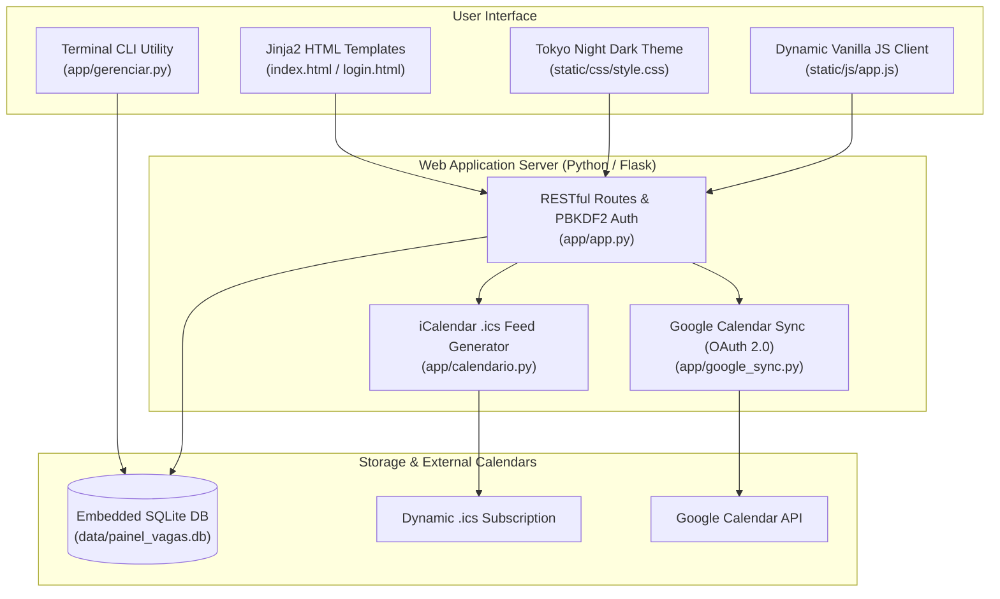

# Technical Application & Internship Pipeline Dashboard (Flask + SQLite)

[](https://python.org)
[](https://flask.palletsprojects.com/)
[](https://sqlite.org/)
[](https://developers.google.com/calendar)
[](LICENSE)

Full-stack web application and CLI terminal utility to track recruitment pipelines, technical interviews, recruiter networking notes, and two-way deadline synchronization with **Google Calendar** and standard **iCalendar (.ics)** feeds.

---

## 🏗️ Application Architecture



---

## ⚡ Key Features

- **Recruitment Pipeline Tracking:** Manage engineering roles, company dossiers, work modes (remote/hybrid/onsite), salary benchmarks, and stage transitions (Applied, Interview, Technical Assessment, Offer).
- **Recruiter & Engineer CRM:** Track contacts, historical interactions, follow-up cadence, and referral connections.
- **Two-Way Calendar Synchronization:**
  - Dynamic `.ics` subscription URL compatible with Apple Calendar, Google Calendar, and Microsoft Outlook.
  - Native Google Calendar OAuth 2.0 integration with automatic event alarms.
- **Terminal CLI (`gerenciar.py`):** Query upcoming interview dates, task deadlines, and recruiter lists directly from the terminal.
- **Security:** Protected by salted PBKDF2-SHA256 hashed PIN authentication and temporary rate-limiting against brute-force attempts.
- **Mock Demonstration Fixtures:** Initial boot automatically populates explicit `[EXAMPLE] (Fictitious)` mock records with zeroed compensation values (`$ 0.00`) for instant component inspection without exposing sensitive real-world records.

---

## 📂 Repository Structure

```
painel-vagas-flask/
├── app/
│   ├── app.py                  # Flask server, REST endpoints & automatic schema migration
│   ├── calendario.py           # RFC 5545 iCalendar (.ics) feed generator
│   ├── google_sync.py          # Google Calendar API integration (OAuth 2.0)
│   ├── gerenciar.py            # Headless terminal CLI utility
│   ├── static/
│   │   ├── css/style.css       # Clean responsive dark stylesheet
│   │   └── js/app.js           # Client-side DOM interactions and AJAX calls
│   └── templates/
│       ├── index.html          # Main pipeline dashboard
│       └── login.html          # Hashed PIN gatekeeper view
├── data/                       # Local SQLite database (gitignored)
├── requirements.txt            # Python dependencies (Flask, requests, etc.)
├── .gitignore                  # Prevents local credentials and DB artifacts from committing
└── README.md
```

---

## 🚀 Setup & Execution

### 1. Installation

```bash
git clone https://github.com/VPariz/painel-vagas-flask.git
cd painel-vagas-flask
python -m venv venv

# Activate virtual environment:
# On Windows:
.\venv\Scripts\activate
# On Linux/macOS:
source venv/bin/activate

pip install -r requirements.txt
```

### 2. Launch Web Application

```bash
python app/app.py
```
Open your browser at `http://127.0.0.1:5000`  
*Default PIN:* `1234` (configurable via login screen or `APP_PIN` environment variable).

### 3. Headless Terminal CLI

```bash
# View pending tasks and approaching deadlines
python app/gerenciar.py tarefas

# View recruiter contacts and message statuses
python app/gerenciar.py contatos

# List all tracked job applications
python app/gerenciar.py vagas
```

---

## 📜 License
This project is licensed under the **MIT License** — see the `LICENSE` file for details.
